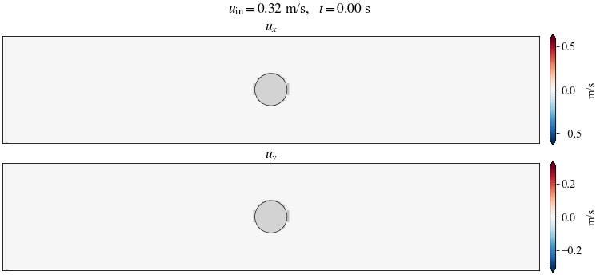
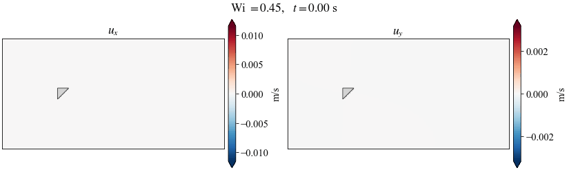

# Physics-guided diffusion models for Newtonian and viscoelastic flows

This repository has the code for training and sampling physics-guided diffusion models that predict the late-time velocity field of a flow past an obstacle from an observed early-time state. There are two cases:

- **Newtonian flow past a cylinder**: incompressible Navier–Stokes, with the inlet velocity varied.
- **Oldroyd-B flow past a triangle**: a viscoelastic flow, with the Weissenberg number varied (Wi = 0.1–1.0).

<p align="center">
  <br>
  <em>Newtonian flow past a cylinder (reference simulation, inlet velocity 0.32 m/s)</em>
</p>
<p align="center">
  <br>
  <em>Oldroyd-B flow past a triangle (reference simulation, Wi = 0.45)</em>
</p>

An unconditional EDM model is trained on the joint distribution of the initial and final velocity fields, $(u_0, v_0, u_T, v_T)$ on a 128×128 grid. At sampling time, the reverse diffusion is guided by three terms:

- the observed initial state (weight $\zeta_a$)
- the no-slip condition on the obstacle (weight $\zeta_u$)
- the continuity residual (weight $\zeta_{pde}$)

The code builds on **[DiffusionPDE](https://github.com/generativepde/DiffusionPDE)** ([Huang et al., 2024](https://arxiv.org/abs/2406.17763)), which in turn builds on **[EDM](https://github.com/NVlabs/edm)** ([Karras et al., 2022](https://arxiv.org/abs/2206.00364)). Please cite both works if you use this code (see [Citation](#citation)).

> **Data and trained models are not included.** The simulation datasets come from an unpublished study and will be released with the paper. The scripts below show how the data is prepared, so the pipeline can be reproduced with your own simulations in the same format.

## What is changed relative to DiffusionPDE

- **New problem setups** ([scripts/generate_cylinder.py](scripts/generate_cylinder.py), [scripts/generate_oldroyd.py](scripts/generate_oldroyd.py)). These are based on DiffusionPDE's bounded Navier–Stokes sampler and add a cylinder or triangle no-slip mask, physical domain sizes and per-case normalization.
- **Continuity residual in physical units.** The fields are normalized separately and the grid spacing differs in x and y, so the residual is computed as
  $R = \partial_j \tilde u + K\, \partial_i \tilde v$, with $K = \dfrac{(v_{max}-v_{min})}{(u_{max}-u_{min})} \dfrac{\Delta x}{\Delta y}$.
  Here $i$ and $j$ are the grid row and column indices. $K$ is computed from the config: 3.73 for the cylinder and 2.18 for the Oldroyd-B case. Without this coefficient, the ground-truth fields themselves give a large residual (57% vs. 6% relative residual for the cylinder), and the guidance pushes the samples away from physical solutions.
- **Command-line overrides** for the test sample, seed, guidance weight, checkpoint and output folder, so that sweeps can be scripted.
- **Data preparation** from COMSOL exports ([data_preparation/](data_preparation/)) and **analysis/plotting** scripts ([analysis/](analysis/)).
- `training/training_loop.py`: `torch.load(..., weights_only=False)`, which resuming needs with PyTorch ≥ 2.6.

`train.py`, `training/`, `dnnlib/` and `torch_utils/` are otherwise unchanged from DiffusionPDE/EDM.

## Repository layout

```
configs/            sampling configs (paths, domain, normalization, guidance weights)
data_preparation/   raw simulations -> normalized training / raw test .npy files
scripts/            physics-guided sampling (one script per case)
analysis/           figures and metrics (sweeps, wake correlation, D(t), loss, GIF)
slurm/              example SLURM jobs for training and sampling
train.py, training/, dnnlib/, torch_utils/   EDM training code (from DiffusionPDE/EDM)
```

## Installation

```bash
conda env create -f environment.yml
conda activate pgdiff-flows
```

Run all commands from the repository root. If Python cannot find `dnnlib` or `torch_utils`, run `export PYTHONPATH="$PWD:$PYTHONPATH"`.

## 1. Data

Expected raw data layout (not included):

```
data/raw/cylinder/u0=<inlet velocity>.csv    COMSOL export: x, y, "u (m/s) @ t=...", "v (m/s) @ t=..."
data/raw/oldroyd/Wi=<Wi>.npz                 pos (T,N,2), vel (T,N,2), Wi, ...
```

Prepare the training and test sets:

```bash
python data_preparation/prepare_cylinder.py --raw-dir data/raw/cylinder
python data_preparation/prepare_oldroyd.py  --raw-dir data/raw/oldroyd
```

Each simulation becomes one `(128, 128, 4)` array `[u0, v0, uT, vT]`. Training samples are scaled to [-1, 1] and go to `data/NS-merged/` and `data/Oldroyd-merged/`. Test samples stay in physical units and go to `data/NS-merged-test/` and `data/Oldroyd-merged-test/`. The scripts write the normalization extrema (and, for Oldroyd-B, the snapshot indices) into the matching config.

**Choice of the initial time.**
- **Cylinder:** 301 snapshots (Δt = 0.01 s, T = 3 s). The CSV headers round time to one decimal, so the first column labelled `t=0.2` is actually t₀ = 0.16 s.
- **Oldroyd-B:** 101 snapshots (T = 10 s). t₀ is the first snapshot at which the inter-sample divergence D(t) reaches 30% of its late-time plateau, which gives t₀ = 0.6 s. See [analysis/plot_divergence.py](analysis/plot_divergence.py).

**Train/test split.**
- **Cylinder:** every other simulation.
- **Oldroyd-B:** 15% test cases, evenly spaced in Wi.

## 2. Training

```bash
# Newtonian / cylinder
torchrun --standalone --nproc_per_node=1 train.py --outdir=training-runs/cylinder \
    --data=data/NS-merged --cond=0 --arch=ddpmpp --batch=15 --tick=10 --snap=25 \
    --dump=100 --duration=300 --ema=0.05

# Oldroyd-B / triangle
torchrun --standalone --nproc_per_node=1 train.py --outdir=training-runs/oldroyd \
    --data=data/Oldroyd-merged --cond=0 --arch=ddpmpp --batch=64 --tick=10 --snap=10 \
    --dump=100 --duration=20 --ema=0.05
```

`--duration` is in millions of training images. To resume a run, add `--resume=<path to training-state-*.pt>`. On SLURM: `sbatch slurm/train.sbatch cylinder` (or `oldroyd`).

## 3. Physics-guided sampling

Set `test.pre-trained` in the config to your network snapshot (or pass `--pretrained`), then run:

```bash
python -m scripts.generate_cylinder --config configs/cylinder-forward.yaml
python -m scripts.generate_oldroyd  --config configs/oldroyd-forward.yaml
```

Any of these options overrides the config: `--datapath`, `--pretrained`, `--iterations`, `--batch-size`, `--zeta-obs-a`, `--seed`, `--tag`, `--outdir`. For example, a sweep over the initial-state weight:

```bash
for za in 10 20 50 100; do
  python -m scripts.generate_cylinder --config configs/cylinder-forward.yaml \
      --datapath data/NS-merged-test/u0_0p32137.npy --zeta-obs-a $za --seed 0
done
```

Each run writes these files to `generate.outdir`:
- `ns_bounded_uv_results[_tri]_<sample>_seed<S>_za<Z><tag>.mat`: the generated initial field `a` and final field `u`, in physical units.
- `ns_bounded_logs[_tri]_<...>.npz`: the losses and gradient norms at each sampling step.

On SLURM: `sbatch slurm/generate.sbatch oldroyd --datapath data/Oldroyd-merged-test/Wi_0p9993.npy --seed 2`.

## 4. Analysis

```bash
# Fields in the physical geometry: a sweep over zeta_a, or over seeds
python analysis/plot_sweep.py --case cylinder --samples u0_0p17388 --zeta-a 10 20 50 100 --seeds 0
python analysis/plot_sweep.py --case oldroyd --samples Wi_0p9993 --zeta-a 500 --seeds 0 1 2 3

# Relative errors and wake correlation rho vs zeta_a; rho per seed
python analysis/plot_metrics.py --case oldroyd \
    --samples Wi_0p1000 Wi_0p2538 Wi_0p4528 Wi_0p6382 Wi_0p9993 \
    --zeta-a 0.1 5 50 100 500 --seeds 0 1 --rho-zeta-a 500

python analysis/plot_divergence.py                    # D(t) and the choice of t0 (needs raw data)
python analysis/plot_training_loss.py training-runs/cylinder/*/stats.jsonl
python analysis/make_velocity_animation.py data/raw/cylinder/u0=0.32137.csv --stride 5 --dpi 75
python analysis/make_velocity_animation.py data/raw/oldroyd/Wi=0.4528.npz --stride 2 --dpi 75 --fps 8
```

The wake correlation $\rho$ is the Pearson correlation of $u_y$ between the generated and reference fields downstream of the obstacle (x > 0.5 for the cylinder, x > −2.7 for the triangle). It is +1 when the vortex street is in phase, 0 when the two are unrelated and −1 when they are in antiphase.

Figures are written to `figures/<case>/`.

## Citation

If you use this code, please cite DiffusionPDE and EDM:

```bibtex
@inproceedings{huang2024diffusionpde,
  title     = {DiffusionPDE: Generative PDE-Solving Under Partial Observation},
  author    = {Huang, Jiahe and Yang, Guandao and Wang, Zichen and Park, Jeong Joon},
  booktitle = {Advances in Neural Information Processing Systems (NeurIPS)},
  year      = {2024},
  eprint    = {2406.17763},
  archivePrefix = {arXiv},
  url       = {https://arxiv.org/abs/2406.17763}
}

@inproceedings{karras2022edm,
  title     = {Elucidating the Design Space of Diffusion-Based Generative Models},
  author    = {Karras, Tero and Aittala, Miika and Aila, Timo and Laine, Samuli},
  booktitle = {Advances in Neural Information Processing Systems (NeurIPS)},
  year      = {2022}
}
```

The paper describing this work (D. Dabiri and S. Jamali, Northeastern University) is in preparation. The citation will be added here when it is available.

## License

This repository is a derivative of DiffusionPDE and EDM. It is released under the same license, [Creative Commons Attribution-NonCommercial-ShareAlike 4.0](LICENSE), so it may be used for non-commercial purposes only, and derivative works must be shared under the same terms.

## Acknowledgments

The training and sampling code is adapted from [DiffusionPDE](https://github.com/generativepde/DiffusionPDE) by Jiahe Huang, Guandao Yang, Zichen Wang and Jeong Joon Park. Their code is in turn built on [EDM](https://github.com/NVlabs/edm) by NVIDIA.
